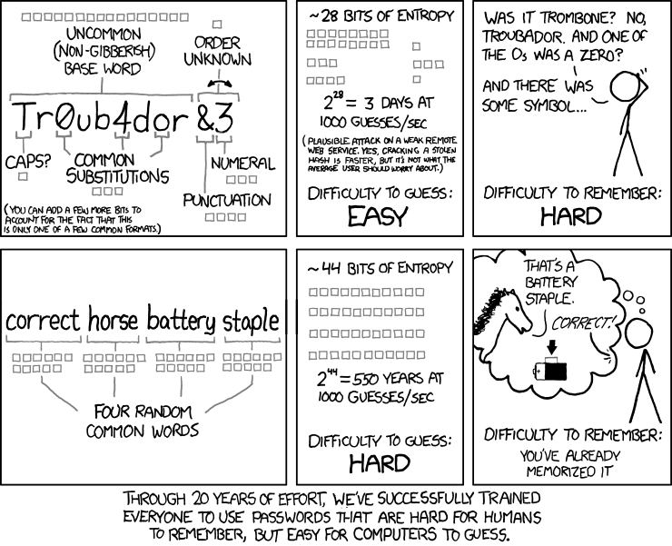
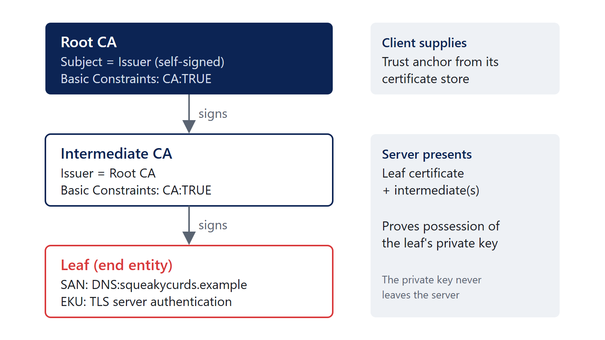

<!--
Full deck, built from outline.md section 4 (Master content outline).
outline.md is the editorial authority; edit there first, then here, then the matching site/ guide.
The Passwords section supersedes passwords.qmd, which is kept as the earlier single-section draft.
Speaker notes hold references and talking points only: nothing about how the deck was made.
Editorial labels go in HTML comments like this one, which do not render:
  PROPOSED = wording that is not David's.
Images take their alt text from the image title ("..."); build.ps1 removes the file path Pandoc appends.
Transcripts use ```smtp (../syntax/smtp.xml): client lines navy, server lines red.
Render with build.ps1 (or: quarto render slides.qmd --output-dir ../output).
-->

## Agenda

1. Passwords
2. PKI
3. Email security
4. PowerShell
5. Building a Windows DFIR box

::: notes
Timing: introduction 5 minutes, passwords 20, PKI 25, email security 30, PowerShell 20, DFIR box 15, questions and wrap-up 5.
:::

## dzampino.github.io/crt-essentials-2026


::: notes
https://dzampino.github.io/crt-essentials-2026/
:::

# Passwords

## Authentication

- Something you know, something you are, something you have
- Passwords are something you know; we refer to them as secrets
  - Other types of secrets: passphrases, PINs, secret questions
- Goal in all authentication methods is **good enough** uniqueness
- We can add behavior to assist in making risk assessments

::: notes
NIST SP 800-63B-4 covers passwords alongside the other authenticator types: https://pages.nist.gov/800-63-4/sp800-63b.html
:::

## correct horse battery staple

xkcd 936, "Password Strength"

<https://xkcd.com/936/>



::: notes
xkcd 936, "Password Strength," by Randall Munroe: https://xkcd.com/936/ (CC BY-NC 2.5).

The explanation holds when the words are randomly selected rather than chosen by a person. The comic's guess rates are historical, not a present-day benchmark.
:::

## Entropy

"My greatest concern was what to call it. I thought of calling it 'information,' but the word was overly used, so I decided to call it 'uncertainty.' When I discussed it with John von Neumann, he had a better idea. Von Neumann told me, 'You should call it entropy, for two reasons. In the first place your uncertainty function has been used in statistical mechanics under that name, so it already has a name. In the second place, and more important, no one really knows what entropy really is, so in a debate you will always have the advantage.'"

— Claude Shannon

::: notes
Claude Shannon, as recounted in M. Tribus and E. C. McIrvine, "Energy and Information," Scientific American 225(3), 1971.
:::

## Entropy (cont.)

- Bits of entropy (aka shannons) = log~2~(search space)
- Search space = alphabet^length^

| Secret | Alphabet | Length | Bits |
|--------|---------:|-------:|-----:|
| 6-digit PIN | 10 | 6 | 19.9 |
| Lowercase | 26 | 8 | 37.6 |
| xkcd words | 2,048 | 4 | 44.0 |
| EFF wordlist | 7,776 | 4 | 51.7 |
| Printable ASCII | 95 | 8 | 52.6 |
| Lowercase | 26 | 15 | 70.5 |

::: notes
The alphabet/length formula assumes each character, or word, is chosen uniformly at random from the alphabet. Human-chosen passwords do not meet that assumption.

Bits = log~2~(alphabet^length^) = length × log~2~(alphabet). xkcd 936 uses 11 bits per word (2,048 words). The EFF large wordlist has 7,776 words (five dice): https://www.eff.org/dice

Get-PasswordEntropy and Get-PasswordLengthForEntropy on the companion site calculate these.
:::

## Entropy calculator

- Multiplicative vs exponential
- Entire search space
- Average time to crack

::: notes
Switch to the companion site for the entropy calculation: dzampino.github.io/crt-essentials-2026/passwords.html

Adding a character multiplies the search space by the alphabet size (adds log~2~(alphabet) bits); doubling the alphabet adds only one bit per character. On average an attacker finds the secret after searching half the space, which is one bit less.
:::

## Cracking = time x money

- Who is the threat
- How is it protected

| Hash (one RTX 5090) | Guesses/second | 8 printable chars, average |
|---------------------|---------------:|---------------------------:|
| NTLM (NT hash) | 340.1 G | 2.7 hours |
| SHA2-256 | 28.4 G | 32.5 hours |
| bcrypt (32 iterations) | 304.8 k | 345 years |

::: notes
Rates: hashcat v6.2.6 benchmark, RTX 5090 Founders Edition, Chick3nman, February 2025: https://gist.github.com/Chick3nman/09bac0775e6393468c2925c1e1363d5c
Average time = (95^8^ / 2) / rate, a full brute force with no wordlist. Real attacks start with wordlists and rules, so human-chosen passwords fall much faster.

Each RTX 5090 draws up to 575 W, all of which becomes heat: about 1,960 BTU/h, or 0.16 tons of cooling per card. The companion site works out power and cooling for each threat level.

A stored Windows NT hash and an NTLM protocol exchange (NetNTLMv2, 16.0 G/s on the same card) are different things.

OWASP Password Storage Cheat Sheet: https://cheatsheetseries.owasp.org/cheatsheets/Password_Storage_Cheat_Sheet.html
Microsoft, Passwords technical overview: https://learn.microsoft.com/en-us/windows-server/security/kerberos/passwords-technical-overview
:::

## Protecting users

- Do what we can to protect users
- Attack modeling should be based on online attacks
- We have duties to protect hashes from getting stolen

::: notes
NIST SP 800-63B-4 section 3.2.2: rate limiting SHALL limit consecutive failed attempts on an account to no more than 100. Section 3.1.1.2: passwords SHALL be salted (at least 32 bits) and hashed with a suitable password hashing scheme; the cost factor SHOULD be as high as practical.
https://pages.nist.gov/800-63-4/sp800-63b.html
:::

## Takeaways

- Uniqueness means password managers
- Check for compromised passwords; no complexity, no rotation
- Use standards otherwise: NIST is 8 with MFA and 15 without MFA
- Use MFA

::: notes
NIST SP 800-63B-4 section 3.1.1.2: minimum 15 characters when a password is used as a single-factor authenticator, 8 when used only as part of MFA; support at least 64 characters; compare against a blocklist; SHALL NOT impose other composition rules; SHALL NOT require periodic changes, but force a change on evidence of compromise.
https://pages.nist.gov/800-63-4/sp800-63b.html
Have I Been Pwned, Pwned Passwords: https://haveibeenpwned.com/Passwords
:::

# Questions? {#passwords-questions}

# PKI

## Public key infrastructure

- Public keys and private keys
  - What one key does, only the other can undo
  - The private key never leaves its owner
- What a certificate does and does not prove
  - A CA bound this public key to this name, for this use, for this time
  - Not that the site is safe, or that the operator is who you think
- Certificate authorities and trust
  - You trust a CA because your certificate store says so

<!-- PROPOSED: the sub-points. -->

::: notes
RFC 5280, Internet X.509 PKI Certificate and CRL Profile: https://www.rfc-editor.org/rfc/rfc5280.html
:::

## What's in a certificate?

:::: columns
::: column
**Fields (X.509 v3)**

- Subject, issuer, serial number
- Validity: not before, not after
- Public key and signature algorithm
- Distinguished names and the common name (CN)
:::

::: column
**Extensions**

- Subject alternative name (SAN)
- Key usage, extended key usage (EKU)
- Basic constraints: CA or end entity
- CRL distribution points, authority information access
:::
::::

::: notes
RFC 5280 section 4.1 (fields) and 4.2 (extensions).

RFC 9525 section 2: "The Common Name RDN MUST NOT be used to identify a service." Names are matched against the SAN. https://www.rfc-editor.org/rfc/rfc9525.html
:::

## Our training certificate

```text
Serial Number: 55:25:8b:df:e8:83:4d:47:...:68:17
Issuer:  O=Cheese Curd Authority, CN=Squeaky Curd Root CA
Not Before: Oct  1 00:00:00 2026 GMT
Not After : Oct  1 00:00:00 2027 GMT
Subject: L=Curdsville, O=Squeaky Curds Co-op, CN=squeakycurds.example
Basic Constraints: critical, CA:FALSE
Subject Alternative Name: DNS:squeakycurds.example
Extended Key Usage: TLS Web Server Authentication
```

::: notes
Inspect it with openssl x509, certutil -dump or XCA.

Output trimmed and condensed from: openssl x509 -in training-leaf.pem -noout -text (OpenSSL 3.5). The full subject also has ST=Wisconsin, C=US.

Training certificates for the Squeaky Curds Co-op; .example is reserved (RFC 2606), so the names do not exist. No private keys are included. Do not install the training root.

XCA, a graphical certificate and key manager: https://hohnstaedt.de/xca/
:::

## Certificate chains

- Leaf, intermediate, root
- Trust anchors and the certificate store
- A valid signature is not the same as a trusted certificate



::: notes
The training sample is a two-level chain: the root signs the leaf directly. Public CAs issue from intermediates.

RFC 5280 section 6 (certification path validation).
:::

## Certificate formats

- ASN.1 describes the structure; DER encodes it as bytes
- PEM is Base64 DER between `-----BEGIN` and `-----END` lines
- A file extension does not necessarily tell you what's inside

| Extension | Usually holds |
|-----------|---------------|
| .cer / .crt | One certificate, DER or PEM |
| .pem | Anything PEM: certificates, keys, CSRs |
| .p7b | PKCS #7 bundle of certificates, no key |
| .pfx / .p12 | PKCS #12: certificate plus private key |
| .csr | PKCS #10 certificate request |

::: notes
RFC 7468 (PEM textual encodings), RFC 7292 (PKCS #12), RFC 5652 (CMS, the basis of .p7b), RFC 2986 (PKCS #10).

training-leaf.pem and training-leaf.der are the same certificate: both have SHA-256 fingerprint 56:6D:45:25:...:AE:67. certutil -dump reads both.

OpenSSL on Windows: it comes with Git for Windows, or winget install ShiningLight.OpenSSL.Light (other builds: https://github.com/openssl/openssl/wiki/Binaries).
:::

## Certificate requests and issuance

- Certificate signing request (CSR / PKCS #10)
  - Create a key pair; the CSR carries the public key and requested names
  - Signed with the private key to prove possession
- Internal CAs / AD CS and certificate templates
  - `certreq -new`, `certreq -submit`, `certreq -accept`
- ACME and automated issuance
  - The CA checks control of the name, then issues

::: notes
RFC 2986 (PKCS #10): https://www.rfc-editor.org/rfc/rfc2986.html
certreq: https://learn.microsoft.com/en-us/windows-server/administration/windows-commands/certreq_1
RFC 8555 (ACME): https://www.rfc-editor.org/rfc/rfc8555.html

The training CSR's public key matches the training leaf: openssl req -in training-request.csr -noout -verify reports "Certificate request self-signature verify OK".
:::

## Putting a certificate to use

- A service needs three things
  - The certificate
  - The private key
  - The intermediate certificates
- The certificate presented by a service versus the trust configured on a client
  - The server sends its chain; the client supplies the root

<!-- PROPOSED: the sub-points. -->

::: notes
A common incident-response finding: a missing intermediate works in one browser (which cached or fetched it) and fails in another client.
:::

## Certificate validation

- Name matching, validity dates, chain, trust, and permitted usage
- CRLs and OCSP; client behavior varies
- What happens when a check fails?

| Check | OpenSSL says |
|-------|--------------|
| Untrusted root | unable to get local issuer certificate |
| Incorrect name | hostname mismatch |
| Expired | certificate has expired |
| Wrong usage | unsuitable certificate purpose |

::: notes
Each row was produced against the training files with openssl verify (OpenSSL 3.5); the commands are on the companion site.

Revocation: Let's Encrypt ended its OCSP service on August 6, 2025 and publishes revocation through CRLs only: https://letsencrypt.org/2025/08/06/ocsp-service-has-reached-end-of-life
Chrome uses CRLSets rather than online checks for most certificates: https://www.chromium.org/Home/chromium-security/crlsets/
:::

## Renewal and maintenance

- Expiration, replacing certificates, and deployment
- Public TLS certificate lifetimes are shrinking
- Automation is no longer optional for public certificates

| Issued on or after | Maximum validity |
|--------------------|-----------------:|
| March 15, 2026 | 200 days |
| March 15, 2027 | 100 days |
| March 15, 2029 | 47 days |

::: notes
CA/Browser Forum Baseline Requirements section 1.2.2, from ballot SC-081v3 (passed April 2025): https://cabforum.org/working-groups/server/baseline-requirements/requirements/

These limits apply to publicly trusted TLS certificates. Internal CAs set their own policy; the training root is not a statement of public Web PKI issuance policy.
:::

# Questions? {#pki-questions}

# Email security

## How email works

- MUA, MSA, MTA, MDA
- SMTP, submission, relay, delivery, and DNS/MX records
- Submission is usually authenticated on 587 or 465, but can be unauthenticated on 25

 submits to the MSA, which relays to the sending MTA. The sending MTA finds the receiving MTA through DNS MX records and sends by SMTP; the receiving MTA looks up SPF, DKIM and DMARC policy and delivers to the MDA, which the recipient client reads. Each hop adds a Received header")

::: notes
RFC 5598, Internet Mail Architecture: https://www.rfc-editor.org/rfc/rfc5598.html
RFC 5321, SMTP: https://www.rfc-editor.org/rfc/rfc5321.html

RFC 6409 section 4.3: the MSA must reject unauthenticated mail by default "unless it has already independently established authentication or authorization (such as being within a protected subnetwork)". Section 3.1: "A site MAY choose to use port 25 for message submission." Printers, scanners and applications relaying through an IP-restricted connector are the everyday example. https://www.rfc-editor.org/rfc/rfc6409.html
:::

## The envelope versus the message

:::: columns
::: column
**Envelope (RFC 5321)**

- `MAIL FROM` and `RCPT TO`
- SMTP commands, not message headers
- The receiver records `MAIL FROM` as `Return-Path`
:::

::: column
**Message (RFC 5322)**

- `From`: the author, what the user sees
- `Sender`: who actually sent it, if different
  - Outlook: "*Sender* on behalf of *From*"
- The visible sender and the envelope sender can differ
:::
::::

::: notes
RFC 5321 section 4.4: the delivering SMTP server inserts Return-Path from the MAIL FROM reverse-path.
RFC 5322 section 3.6.2: From, Sender, Reply-To.
:::

## Reading email headers

- `Received` headers and the path a message took
  - Each hop adds one at the top; read from the bottom up
- `Authentication-Results` and which system added them
  - Trust the one your own boundary added
- Which headers can be trusted?
  - Only those added by systems you control; everything below can be forged
- My preferred tool: Microsoft's Message Header Analyzer

<!-- PROPOSED: the sub-points. -->

::: notes
RFC 8601, Authentication-Results: https://datatracker.ietf.org/doc/html/rfc8601

Message Header Analyzer: paste headers at https://mha.azurewebsites.net/pages/mha.html, or install the Outlook add-in. Source: https://github.com/microsoft/MHA
:::

## SPF

- What SPF checks: is this IP allowed to send for the envelope domain?
  - The IP: the server connecting to the receiver, not anything in the message
  - The domain: `MAIL FROM`, or the `HELO`/`EHLO` name when `MAIL FROM` is empty
- DNS records, sending IPs, and envelope domains
- SPF pass does not necessarily mean DMARC pass

<!-- PROPOSED: the two sub-points. -->

```text
red.secondary.com.  TXT  "v=spf1 ip4:182.107.92.190 -all"
```

::: notes
RFC 7208: SPF checks the MAIL FROM domain (or the HELO domain when MAIL FROM is empty), not the From header. https://www.rfc-editor.org/rfc/rfc7208.html
Section 4.1: the IP is "the IP address of the SMTP client that is emitting the mail". Section 2.3 also recommends checking the HELO identity on its own; section 2.4 covers the empty MAIL FROM of bounces, where the check uses postmaster@ the HELO name.

Record from learndmarc.com example 1.
:::

## SPF record terms

| Term | Meaning |
|------|---------|
| `v=spf1` | Version; must come first |
| `ip4:` / `ip6:` | This address or range may send |
| `a` / `mx` | The domain's A/AAAA or MX hosts may send |
| `include:` | Matches if the other domain's SPF check passes |
| `redirect=` | Use another domain's record instead of this one |
| `all` | Matches everything; the last term, so the default answer |
| `+` `-` `~` `?` | Qualifier in front of a term: pass (the default), fail, softfail, neutral |

<!-- PROPOSED: slide added so the audience can work the examples. -->

::: notes
RFC 7208 sections 4.6.2 (qualifiers), 5 (mechanisms) and 6 (modifiers): https://www.rfc-editor.org/rfc/rfc7208.html
Section 4.6.4: include, a, mx, ptr, exists and redirect cause DNS lookups; more than 10 in one evaluation is a permerror.
ptr SHOULD NOT be published (section 5.5). exists and exp= are the other terms.
:::

## DKIM

- What DKIM signs and verifies: selected headers and the body
- Signing domain (`d=`), selector (`s=`), and DNS public key
- The relevant fields in a DKIM signature

```text
DKIM-Signature: v=1; a=rsa-sha256; d=primary.com; s=selector;
    h=from:to:subject:date; bh=...; b=...
selector._domainkey.primary.com  TXT  "v=DKIM1; k=rsa; p=..."
```

::: notes
RFC 6376: https://www.rfc-editor.org/rfc/rfc6376.html
The d= domain does not have to match the From domain; DMARC is what requires alignment.
:::

## DKIM signature tags

| Tag | Meaning |
|-----|---------|
| `v=1` | Version |
| `a=` | Algorithm: `rsa-sha256` (or `ed25519-sha256`) |
| `d=` | Signing domain; DMARC aligns this with `From` |
| `s=` | Selector: the public key is at `s._domainkey.d` |
| `h=` | The header fields that were signed |
| `bh=` / `b=` | Hash of the body / the signature itself |
| `c=` | Canonicalization, header/body: `simple` or `relaxed`; default `simple/simple` |
| `l=` | Only this many body bytes are signed; text can be added after them |

<!-- PROPOSED: slide added so the audience can work the examples. -->

::: notes
RFC 6376 section 3.5 (signature tags) and 3.6.1 (key record): https://www.rfc-editor.org/rfc/rfc6376.html
Key record: v=DKIM1; k=rsa (the default); p= is the public key, and an empty p= means the key has been revoked.
t= and x= are the signing time and expiry; i= is the identity on whose behalf it was signed.
RFC 8301: signers must not use rsa-sha1. RFC 8463 adds ed25519-sha256.
:::

## DMARC

- Start with the domain in the message `From` header
- Alignment with SPF and/or DKIM: a pass **and** a matching domain
- Strict versus relaxed alignment
  - Strict: identical domains
  - Relaxed: same organizational domain
- DMARC policy and reporting: `p=none | quarantine | reject`, `rua=`

::: notes
RFC 9989 (May 2026, Standards Track) obsoletes RFC 7489 and RFC 9091. Section 3.2.10 defines strict and relaxed alignment; adkim and aspf default to r (relaxed).
Changes: pct, rf and ri removed; t (test mode), np and psd added; organizational domain found by a DNS tree walk instead of a public suffix list.
https://www.rfc-editor.org/rfc/rfc9989.html
Aggregate reports: RFC 9990. Failure reports: RFC 9991.
:::

## DMARC record tags

| Tag | Meaning | Default |
|-----|---------|---------|
| `v=DMARC1` | Version; must be the first tag | Required |
| `p=` | Policy for the domain: `none`, `quarantine`, `reject` | `none` |
| `sp=` | Policy for existing subdomains | `p` |
| `np=` | Policy for non-existent subdomains | `sp`, then `p` |
| `adkim=` | DKIM alignment: `r` relaxed, `s` strict | `r` |
| `aspf=` | SPF alignment: `r` relaxed, `s` strict | `r` |
| `t=y` | Test mode: apply one level below `p` (`quarantine` becomes `none`, `reject` becomes `quarantine`) | `n` |
| `rua=` / `ruf=` | Where to send aggregate / failure reports | No reports |

<!-- PROPOSED: slide added so the audience can work the examples. -->

::: notes
RFC 9989 section 4.7 defines every tag; fo= (failure report options) and psd= (public suffix domain flag) are the others. Unknown tags must be ignored.
https://www.rfc-editor.org/rfc/rfc9989.html#section-4.7
:::

## Work through it: example 1

```smtp
> HELO red.secondary.com
. 250 smtp.learndmarc.com Hello red.secondary.com <153.112.107.49>
> MAIL FROM: <gina@red.secondary.com>
> From: "Gina" <gina@blue.secondary.com>
> DKIM-Signature: v=1; a=rsa-sha256; d=primary.com; s=selector;
  (DKIM Auth Result: PASS)

_dmarc.blue.secondary.com: "v=DMARC1; p=quarantine; t=y;"
red.secondary.com:  "v=spf1 ip4:182.107.92.190 -all"
blue.secondary.com: "v=spf1 ip4:24.121.50.128 ~all"
```

::: notes
Transcript from learndmarc.com, abridged. Lines starting > are the client; lines starting . are the server. Ask: what are the sender identities, what did SPF and DKIM return, and does it pass DMARC?
:::

## Example 1: answer

- **DMARC fails, but the message will not be treated as suspicious**
- SPF uses `red.secondary.com` (MAIL FROM); DMARC uses `blue.secondary.com` (From)
- SPF fails: 153.112.107.49 is not allowed for `red.secondary.com`
- DKIM passes, but `primary.com` does not align with `secondary.com`
- Relaxed alignment applies (no `adkim`/`aspf`)
- `t=y` is test mode: receivers are asked not to apply the policy

## Work through it: example 2

```smtp
> HELO red.primary.com
. 250 smtp.learndmarc.com Hello red.primary.com <97.196.174.88>
> MAIL FROM: <terry@red.primary.com>
> From: "Terry" <terry@blue.primary.com>
> DKIM-Signature: v=1; a=rsa-sha256; d=secondary.com; s=selector;
  (DKIM Auth Result: FAIL)

_dmarc.blue.primary.com: "v=DMARC1; p=quarantine; adkim=s; aspf=s;"
red.primary.com:  "v=spf1 ip4:95.129.128.101 ~all"
blue.primary.com: "v=spf1 ip4:44.62.173.139 ~all"
```

::: notes
Transcript from learndmarc.com, abridged.
:::

## Example 2: answer

- **DMARC fails, and the message will be quarantined**
- SPF uses `red.primary.com`; DMARC uses `blue.primary.com`
- SPF fails: 97.196.174.88 is not allowed for `red.primary.com`
- DKIM fails validation: the message has been altered
- Strict alignment: domains must match exactly
- Neither SPF nor DKIM passed with alignment; `p=quarantine`

## Work through it: example 3

```smtp
> HELO blue.secondary.com
. 250 smtp.learndmarc.com Hello blue.secondary.com <156.157.23.197>
> MAIL FROM: <ray@blue.secondary.com>
> From: "Ray" <ray@red.primary.com>
> DKIM-Signature: v=1; a=rsa-sha256; d=blue.primary.com; s=selector;
  (DKIM Auth Result: PASS)

_dmarc.red.primary.com: "v=DMARC1; p=none; adkim=s; aspf=s;"
blue.secondary.com: "v=spf1 ip4:62.165.120.61 ~all"
red.primary.com:    "v=spf1 ip4:156.157.23.197 -all"
```

::: notes
Transcript from learndmarc.com, abridged. Note the trap: the sending IP is listed in red.primary.com's SPF record, but SPF is evaluated against the MAIL FROM domain.
:::

## Example 3: answer

- **DMARC fails, but no action is taken**
- SPF uses `blue.secondary.com`; DMARC uses `red.primary.com`
- SPF fails: 156.157.23.197 is not allowed for `blue.secondary.com`
- DKIM passes, but strict alignment: `blue.primary.com` ≠ `red.primary.com`
  - Under relaxed alignment, DKIM would have aligned
- `p=none`: monitoring only

::: notes
Both domains share the organizational domain primary.com, which is why relaxed alignment would have passed.
:::

## Other email security mechanisms

- MTA-STS and TLS reporting (TLS-RPT)
  - MTA-STS: publish that your MX requires TLS with a valid certificate
  - TLS-RPT: receive reports when senders cannot negotiate TLS
- Sender ID
  - Checked a "purported responsible address" taken from the headers; the experiment was concluded in favor of SPF (RFC 6686, 2012)

::: notes
RFC 8461 (MTA-STS): https://www.rfc-editor.org/rfc/rfc8461.html
RFC 8460 (TLS-RPT): https://www.rfc-editor.org/rfc/rfc8460.html
RFC 6686 (Sender ID and SPF experiment resolution): https://www.rfc-editor.org/rfc/rfc6686.html
:::

# Questions? {#email-questions}

# PowerShell

## Why PowerShell?

- Administration, automation, and analysis
- Turning a repetitive task into something repeatable
- Objects, not text: no parsing columns with regex

<!-- PROPOSED: the third point. -->

::: notes
Get-Member shows the properties and methods of whatever a command returns.
:::

## Verb-Noun

- Every command is named *Verb-Noun*: `Get-Process`, `Stop-Service`, `Export-Csv`
- A short list of approved verbs: `Get`, `Set`, `New`, `Remove`, `Start`, `Stop`, `Export`...
- Learn the noun, then guess the verb
- Parameters follow: `-Name value`; Tab completes both

```powershell
Get-Verb                       # the approved verbs
Get-Command -Noun Service      # every verb that works on services
Get-Service -Name Spooler
```

<!-- PROPOSED: slide added for the PowerShell introduction. -->

::: notes
Approved verbs: https://learn.microsoft.com/en-us/powershell/scripting/developer/cmdlet/approved-verbs-for-windows-powershell-commands
:::

## Objects

- An object is a thing with **properties** (data) and **methods** (actions)
  - A file: `Name`, `Length`, `LastWriteTime`; `CopyTo()`, `Delete()`
- Commands return objects, not text; the table on screen is only a view
- Ask for a property by name instead of cutting columns out of text

```powershell
$File = Get-Item C:\Windows\notepad.exe
$File.Length                  # a property: size in bytes
$File.LastWriteTime.Year      # a property can be an object too
$File | Get-Member            # every property and method
```

<!-- PROPOSED: slide added for the PowerShell introduction. -->

::: notes
about_Objects: https://learn.microsoft.com/en-us/powershell/module/microsoft.powershell.core/about/about_objects
:::

## Windows PowerShell 5.1 and PowerShell 7

| | Windows PowerShell 5.1 | PowerShell 7 |
|---|---|---|
| Comes from | Built into Windows | Installed alongside it: `winget install Microsoft.PowerShell` |
| Starts with | `powershell.exe` | `pwsh.exe` |
| Built on | .NET Framework | Current .NET; also runs on Linux and macOS |
| Status | Maintained, not developed further | Where new features go |
| Which am I in? | `$PSVersionTable.PSVersion` | `$PSVersionTable.PSVersion` |

<!-- PROPOSED: slide added for the PowerShell introduction. -->

::: notes
Differences between Windows PowerShell 5.1 and PowerShell 7.x: https://learn.microsoft.com/en-us/powershell/scripting/whats-new/differences-from-windows-powershell
The ones that bite: default file encoding, Export-Csv's type line in 5.1, and modules folders in different places. The companion site has a table.
:::

## Default security settings

- Double-clicking a `.ps1` opens it in Notepad; it does not run
- A script runs only by path: `.\Get-Report.ps1`, not `Get-Report.ps1`
- Execution policy
  - Windows PowerShell 5.1: `Restricted` on Windows clients, `RemoteSigned` on Windows Server
  - PowerShell 7 on Windows: `RemoteSigned`
  - `RemoteSigned`: scripts downloaded from the internet must be signed, or unblocked with `Unblock-File`
- Not a security boundary: the commands can always be pasted in

```powershell
Get-ExecutionPolicy -List
Set-ExecutionPolicy -ExecutionPolicy RemoteSigned -Scope CurrentUser
```

<!-- PROPOSED: slide added for default security settings. -->

::: notes
about_Scripts: "As a security feature, PowerShell does not run scripts when you double-click the script icon in File Explorer or when you type the script name without a full path, even when the script is in the current directory." Right-click, Run with PowerShell, does run it.
about_Execution_Policies: if every scope is Undefined, the effective policy is Restricted for Windows clients and RemoteSigned for Windows Server. "The execution policy isn't a security boundary, it's defense in depth." On Linux and macOS it is Unrestricted and cannot be changed.
PowerShell 7 sets RemoteSigned in $PSHOME\powershell.config.json.
https://learn.microsoft.com/en-us/powershell/module/microsoft.powershell.core/about/about_execution_policies
:::

## Finding commands

- `Get-Command`, `Get-Help`
- Find the parameters and figure out what a command returns

```powershell
Get-Command -Noun WinEvent
Get-Help Get-WinEvent -Parameter FilterHashtable
Get-Command Get-FileHash -Syntax
(Get-Command Get-FileHash).OutputType
```

::: notes
Get-Help shows local help; run Update-Help once (as administrator in Windows PowerShell 5.1) or use Get-Help -Online.
:::

## Objects and the pipeline

- Objects versus plain text
- `Get-Member`, `Select-Object`
- Pass objects between commands

```powershell
Get-Item C:\Windows\notepad.exe | Get-Member -MemberType Property
Get-Item C:\Windows\notepad.exe |
	Select-Object Name, Length, LastWriteTime, VersionInfo
```

::: notes
about_Pipelines: https://learn.microsoft.com/en-us/powershell/module/microsoft.powershell.core/about/about_pipelines
:::

## Working with data

- `Where-Object`, `Sort-Object`, `Group-Object`
- Selecting information and exporting results

```powershell
Get-ChildItem -Path .\Case -Recurse -File |
	Where-Object Length -gt 10MB |
	Sort-Object Length -Descending |
	Select-Object FullName, Length, LastWriteTimeUtc |
	Export-Csv .\LargeFiles.csv -NoTypeInformation
```

::: notes
Export-Csv: https://learn.microsoft.com/en-us/powershell/module/microsoft.powershell.utility/export-csv
-NoTypeInformation is the default in PowerShell 7 and needed in Windows PowerShell 5.1.
:::

## Example: file metadata and hashing

```powershell
Get-ChildItem -Path .\Case -Recurse -File |
	Get-FileHash -Algorithm SHA256 |
	Select-Object Hash, Path |
	Export-Csv .\Hashes.csv -NoTypeInformation

Get-ChildItem -Path .\Case -Recurse -File |
	Group-Object Extension |
	Sort-Object Count -Descending |
	Select-Object Count, Name
```

::: notes
Working with an existing collection of files. Get-FileInventory, on the companion site, combines these into one function.
:::

## Example: collected event logs

```powershell
Get-WinEvent -FilterHashtable @{
	Path = '.\Case\Security.evtx'
	Id = 4624, 4625
} |
	Group-Object Id |
	Select-Object Count, Name
```

- Query a copied `.evtx`, not the live log
- `-FilterHashtable` filters before objects reach the pipeline

::: notes
Get-WinEvent: https://learn.microsoft.com/en-us/powershell/module/microsoft.powershell.diagnostics/get-winevent
4624 is a successful logon, 4625 a failed logon. Get-EvtxSummary and Get-LogonEvent on the companion site extend this.
:::

## Making a script reusable

- Parameters instead of hard-coded values
- Functions, `-Verbose`, `-WhatIf` where applicable
- An example of automating part of the DFIR box build

```powershell
function New-CaseFolder {
	[CmdletBinding()]
	param([Parameter(Mandatory)][string]$Path)
	'Collected', 'Output', 'Notes' | ForEach-Object {
		Write-Verbose "Creating $Path\$_"
		New-Item -Path "$Path\$_" -ItemType Directory -Force
	}
}
```

::: notes
New-CaseFolder -Path E:\Cases\2026-0142 -Verbose
[CmdletBinding()] is what makes -Verbose work. The version on the companion site also supports -WhatIf.
about_Functions_CmdletBindingAttribute: https://learn.microsoft.com/en-us/powershell/module/microsoft.powershell.core/about/about_functions_cmdletbindingattribute
:::

## Your own module

- A `.psm1` file of functions, in a folder of the same name
- Put it in your personal Modules folder and PowerShell loads it for you
- `$env:PSModulePath` lists every folder PowerShell searches

```text
PowerShell 7
    Documents\PowerShell\Modules\MyTools\MyTools.psm1
Windows PowerShell 5.1
    Documents\WindowsPowerShell\Modules\MyTools\MyTools.psm1

Get-Command -Module MyTools        # in a new window
```

<!-- PROPOSED: slide added for the module item (outline 4.1 item 7). -->

::: notes
about_Modules: https://learn.microsoft.com/en-us/powershell/module/microsoft.powershell.core/about/about_modules
Every function on the companion site is in its own copyable block, ready to paste into MyTools.psm1. The companion site walks through creating the folder and file.
:::

# Questions? {#powershell-questions}

# Building a Windows DFIR box

## What we're building

- A Windows analysis machine, not an evidence acquisition machine
- Evidence is already collected
- A disposable VM that returns to a known state after every case
- Evidence comes in read-only; output, logs and notes go back to the host
- Windows Server 2025 and the common DFIR tools, built from an unattend file
- Offline while working a case

<!-- PROPOSED: the last four points. -->

::: notes
Memory acquisition is handled separately (Magnet in our workflow).
:::

## Disposable/nonpersistent virtual machine

:::: columns
::: column
**Return the machine to a known state**

- VMware Workstation Pro
- System disk: independent, non-persistent
- Power off, and every change is gone
:::

::: column
**Keep case data and analysis output separate from what gets reset**

- Shared Folders on the host
- Evidence: read-only
- Cases (output, logs, notes): read-write
:::
::::

::: notes
Independent non-persistent disks discard changes at power-off: https://docs.vmware.com/en/VMware-Workstation-Pro/17/com.vmware.ws.using.doc/GUID-A6792F54-2734-4AF4-9473-C8B9AD8321AF.html
Workstation Pro is free for commercial, educational and personal use since November 2024: https://knowledge.broadcom.com/external/article/368667/download-and-license-vmware-desktop-hypervisor.html
In the guest, shared folders are at \\vmware-host\Shared Folders\.
:::

## Automating the build

- Decide on the Windows image and tool list
  - Windows Server 2025: stable, Defender is a removable feature, no TPM needed
- Make setup repeatable rather than configuring it by hand each time
  - An unattend file: schneegans.de/windows/unattend-generator

::: notes
Windows Server hardware requirements list a TPM as required only for certain features: https://learn.microsoft.com/en-us/windows-server/get-started/hardware-requirements
Defender on Windows Server is the Windows-Defender feature: https://learn.microsoft.com/en-us/defender-endpoint/microsoft-defender-antivirus-windows-server-configure
The 180-day evaluation must be activated online within its first 10 days.
The unattend generator is written for Windows 10 and 11. For Server 2025, enter the product key (generic or real) and select the image by name or index.
Setup finds Autounattend.xml at the root of removable media: a second small ISO, or the Windows ISO rebuilt with oscdimg. Steps are on the companion site.
:::

## Configuring Windows for analysis

- Tools that need to run as administrator
- Windows security settings as decisions specific to this machine, not general recommendations
  - Normally I don't disable security features, but this is a disposable VM and reducing friction matters
- The changes
  - UAC off, Defender removed
  - Long paths on, last-access updates off
  - File extensions and hidden files shown
  - Clock: UTC, or a second clock set to UTC

<!-- PROPOSED: "The changes" grouping, the last-access item and the clock item. -->

::: notes
UAC off: EnableLUA = 0. Defender: Uninstall-WindowsFeature -Name Windows-Defender. Long paths: LongPathsEnabled = 1. All of these are options in the unattend generator. Commands are on the companion site.
:::

## Tools for analysis

- Select the tools and versions
  - Eric Zimmerman's tools, KAPE, FTK Imager, Volatility 3, Plaso
  - Chainsaw, Hayabusa, Autopsy, Office if licensed
- Chocolatey installs most of them in one line
- KAPE modules for processing already-collected artifacts
  - Targets collect; modules process what was collected

```powershell
choco install -y ericzimmermantools volatility3 autopsy
```

::: notes
The full line on the companion site also installs 7-Zip, Sysinternals and PowerShell 7.
KAPE, FTK Imager, Chainsaw and Hayabusa are direct downloads; Chocolatey's "chainsaw" package is a different program. Plaso runs in WSL (Ubuntu, GIFT PPA).
KAPE and the community KapeFiles repository: https://github.com/EricZimmerman/KapeFiles
KAPE is free for CRT members; commercial use needs a Kroll enterprise license: https://www.kroll.com/en/kape-license-agreement
:::

## Suggested tool list

- Parsing and timelines: Eric Zimmerman's tools, KAPE, Chainsaw, Hayabusa, Plaso
- Disk images and memory: FTK Imager, Arsenal Image Mounter, Autopsy, Volatility 3
- Files, documents and network: CyberChef, ExifTool, pestudio, oletools, Wireshark
- Basics: 7-Zip, Sysinternals, VS Code, PowerShell 7, Office if licensed
- Linux tools: WSL 1

<!-- PROPOSED: slide added for David's tool list; grouping and wording. -->

::: notes
The common Windows tools from DFIR distributions such as FLARE-VM and the SIFT Workstation. Install commands are on the companion site.
WSL 2 needs nested virtualization, which VMware Workstation cannot provide while the host runs Hyper-V or virtualization-based security (Broadcom KB 389469). WSL 1 does not use virtualization: wsl.exe --install --enable-wsl1 --no-distribution, then wsl.exe --set-default-version 1.
:::

## Using and resetting the box

- Run tools against existing artifacts
- Retain the results and relevant logs
- Verify the environment and reset it for the next case

::: notes
Read from the read-only Evidence share, write to Cases. Before power-off, confirm the output is on the Cases share; after power-on, confirm the system disk is clean.
:::

# Questions? {#dfir-questions}

# Thank you {#thank-you}
