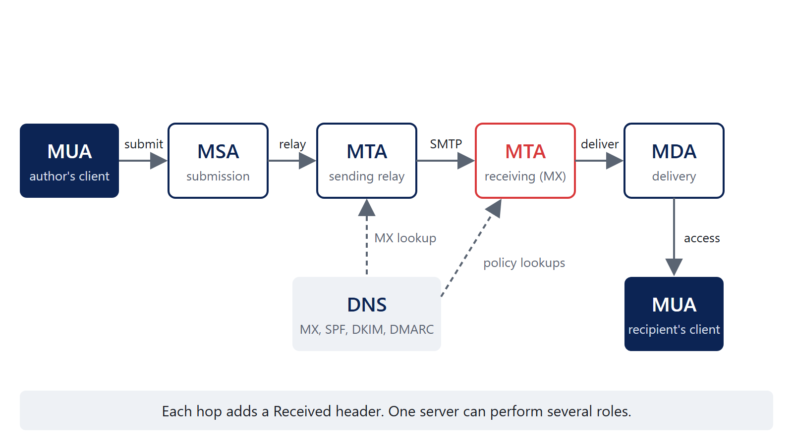

<!--
Full deck, built from outline.md section 4 (Master content outline).
outline.md is the editorial authority; edit there first, then here, then the matching site/ guide.
The Passwords section supersedes passwords.qmd, which is kept as the earlier single-section draft.
Speaker notes hold references, review notes and placeholders, not David's prose.
"Proposed wording" in a note marks a suggestion that is not David's.
Render with build.ps1 (or: quarto render slides.qmd --output-dir ../output).
-->

## Agenda

| Segment | Minutes |
|---------|--------:|
| Introduction and purpose | 5 |
| Passwords | 20 |
| PKI | 25 |
| Email security | 30 |
| PowerShell | 20 |
| Building a Windows DFIR box | 15 |
| Questions and wrap-up | 5 |

::: notes
Timing is the proposed pacing budget from outline.md section 3. Demonstrations are included within each section's allocation.
:::

## Why these five topics

- Practical security knowledge CRT responders should understand and be able to explain
- Including the preventative advice that helps organizations avoid the incidents we respond to
- No single fictional incident; each topic stands on its own
- Slides for today, a field guide for afterward

**Companion site:** dzampino.github.io/crt-essentials-2026

::: notes
Proposed wording, drawn from outline.md section 1.

The companion site holds the calculators, sample files, commands, scripts and references that do not fit in a two-hour session.
:::

# Passwords

## Authentication

- Something you know, something you are, something you have
- Passwords are something you know; we refer to them as secrets
  - Other types of secrets: passphrases, PINs, secret questions
- Goal in all authentication methods is **good enough** uniqueness
- We can add behavior to assist in making risk assessments

::: notes
[David's notes to add.]
:::

## correct horse battery staple

xkcd 936, "Password Strength"

<https://xkcd.com/936/>


::: notes
xkcd 936, "Password Strength," by Randall Munroe: https://xkcd.com/936/ (CC BY-NC 2.5).

Review note (outline section 5): the explanation holds when the words are randomly selected rather than chosen by a person; the comic's guess rates are historical, not a present-day benchmark.
:::

## Entropy

"My greatest concern was what to call it. I thought of calling it 'information,' but the word was overly used, so I decided to call it 'uncertainty.' When I discussed it with John von Neumann, he had a better idea. Von Neumann told me, 'You should call it entropy, for two reasons. In the first place your uncertainty function has been used in statistical mechanics under that name, so it already has a name. In the second place, and more important, no one really knows what entropy really is, so in a debate you will always have the advantage.'"

— Claude Shannon

::: notes
Claude Shannon, as recounted in M. Tribus and E. C. McIrvine, "Energy and Information," Scientific American 225(3), 1971.
:::

## Entropy (cont.)

- Bits of entropy (aka shannons) = log~2~(search space)
- Search space = alphabet ^ length

| Secret | Alphabet | Length | Bits |
|--------|---------:|-------:|-----:|
| 6-digit PIN | 10 | 6 | 19.9 |
| Lowercase | 26 | 8 | 37.6 |
| xkcd words | 2,048 | 4 | 44.0 |
| EFF wordlist | 7,776 | 4 | 51.7 |
| Printable ASCII | 95 | 8 | 52.6 |
| Lowercase | 26 | 15 | 70.5 |

::: notes
Review note (outline section 5): the pool/length formula assumes each character, or word, is chosen uniformly at random from the alphabet. Human-chosen passwords do not meet that assumption.

Table values computed as log2(alphabet^length). xkcd 936 uses 11 bits per word (2,048 words). The EFF large wordlist has 7,776 words (five dice): https://www.eff.org/dice
:::

## Entropy calculator

- Multiplicative vs exponential
- Entire search space
- Average time to crack

::: notes
SWAP TO SITE for the entropy calculation: dzampino.github.io/crt-essentials-2026/passwords.html

Points to show: adding a character multiplies the search space by the alphabet size (adds log2(alphabet) bits); doubling the alphabet adds only one bit per character. On average an attacker finds the secret after searching half the space, which is one bit less.
:::

## Cracking = time x money

- Who is the threat
- How is it protected

| Hash (one RTX 5090) | Guesses/second | 8 printable chars, average |
|---------------------|---------------:|---------------------------:|
| NTLM (NT hash) | 340.1 G | 2.7 hours |
| SHA2-256 | 28.4 G | 32.5 hours |
| bcrypt (32 iterations) | 304.8 k | 345 years |

::: notes
Companion site: hashing algorithms, threat levels, time and cost to crack.

Rates: hashcat v6.2.6 benchmark, RTX 5090 Founders Edition, Chick3nman, February 2025: https://gist.github.com/Chick3nman/09bac0775e6393468c2925c1e1363d5c
Average time = (95^8 / 2) / rate, a full brute force with no wordlist. Real attacks start with wordlists and rules, so human-chosen passwords fall much faster.

Review note (outline section 5): a stored Windows NT hash and an NTLM protocol exchange (NetNTLMv2, 16.0 G/s on the same card) are different comparison subjects.

OWASP Password Storage Cheat Sheet: https://cheatsheetseries.owasp.org/cheatsheets/Password_Storage_Cheat_Sheet.html
Microsoft, Passwords technical overview: https://learn.microsoft.com/en-us/windows-server/security/kerberos/passwords-technical-overview
:::

## Protecting users

- Do what we can to protect users
- Attack modeling should be based on online attacks
- We have duties to protect hashes from getting stolen

::: notes
[David's notes to add.]

NIST SP 800-63B-4 section 3.2.2: rate limiting SHALL limit consecutive failed attempts on an account to no more than 100. Section 3.1.1.2: passwords SHALL be salted (at least 32 bits) and hashed with a suitable password hashing scheme; the cost factor SHOULD be as high as practical.
https://pages.nist.gov/800-63-4/sp800-63b.html
:::

## Takeaways

- Uniqueness means password managers
- Check for compromised passwords; no complexity, no rotation
- Use standards otherwise: NIST is 8 with MFA and 15 without MFA
- Use MFA

::: notes
NIST SP 800-63B-4 section 3.1.1.2: minimum 15 characters when a password is used as a single-factor authenticator, 8 when used only as part of MFA; support at least 64 characters; compare against a blocklist; SHALL NOT impose other composition rules; SHALL NOT require periodic changes, but force a change on evidence of compromise.
https://pages.nist.gov/800-63-4/sp800-63b.html
Have I Been Pwned, Pwned Passwords: https://haveibeenpwned.com/Passwords
:::

# Questions? {#passwords-questions}

# PKI

## Public key infrastructure

- Public keys and private keys
  - What one key does, only the other can undo
  - The private key never leaves its owner
- What a certificate does and does not prove
  - A CA bound this public key to this name, for this use, for this time
  - Not that the site is safe, or that the operator is who you think
- Certificate authorities and trust
  - You trust a CA because your certificate store says so

::: notes
Proposed wording for the sub-points.

RFC 5280, Internet X.509 PKI Certificate and CRL Profile: https://www.rfc-editor.org/rfc/rfc5280.html
:::

## What's in a certificate?

:::: columns
::: column
**Fields (X.509 v3)**

- Subject, issuer, serial number
- Validity: not before, not after
- Public key and signature algorithm
- Distinguished names and the common name (CN)
:::

::: column
**Extensions**

- Subject alternative name (SAN)
- Key usage, extended key usage
- Basic constraints: CA or end entity
- CRL distribution points, authority information access
:::
::::

::: notes
RFC 5280 section 4.1 (fields) and 4.2 (extensions).

RFC 9525 section 2: "The Common Name RDN MUST NOT be used to identify a service." Names are matched against the SAN. https://www.rfc-editor.org/rfc/rfc9525.html

Companion site: field reference with OIDs.
:::

## Our training certificate

```text
Serial Number: 05:6d:6d:da:99:ef:6a:99:e4:fe:...:0a:94
Issuer:  CN=CRT Fictional Training Root
Not Before: Oct  1 00:00:00 2026 GMT
Not After : Oct  1 00:00:00 2027 GMT
Subject: CN=training.example
Basic Constraints: critical, CA:FALSE
Subject Alternative Name: DNS:training.example
Extended Key Usage: TLS Web Server Authentication
```

::: notes
Output trimmed and condensed from: openssl x509 -in training-leaf.pem -noout -text (OpenSSL 3.5).

The sample files are fictional training certificates; no private keys are included. Do not install the training root. Download them from the companion site.
:::

## Certificate chains

- Leaf, intermediate, root
- Trust anchors and the certificate store
- A valid signature is not the same as a trusted certificate


::: notes
The training sample is a two-level chain: the root signs the leaf directly. Public CAs issue from intermediates.

RFC 5280 section 6 (certification path validation).
:::

## Certificate formats

- ASN.1 describes the structure; DER encodes it as bytes
- PEM is Base64 DER between `-----BEGIN` and `-----END` lines
- A file extension does not necessarily tell you what's inside

| Extension | Usually holds |
|-----------|---------------|
| .cer / .crt | One certificate, DER or PEM |
| .pem | Anything PEM: certificates, keys, CSRs |
| .p7b | PKCS #7 bundle of certificates, no key |
| .pfx / .p12 | PKCS #12: certificate plus private key |
| .csr | PKCS #10 certificate request |

::: notes
RFC 7468 (PEM textual encodings), RFC 7292 (PKCS #12), RFC 5652 (CMS, the basis of .p7b), RFC 2986 (PKCS #10).

training-leaf.pem and training-leaf.der are the same certificate: both have SHA-256 fingerprint 3B:44:01:67:...:17:E2. certutil -dump reads both.
:::

## Certificate requests and issuance

- Certificate signing request (CSR / PKCS #10)
  - Create a key pair; the CSR carries the public key and requested names
  - Signed with the private key to prove possession
- Internal CAs / AD CS and certificate templates
  - `certreq -new`, `certreq -submit`, `certreq -accept`
- ACME and automated issuance
  - The CA checks control of the name, then issues

::: notes
RFC 2986 (PKCS #10): https://www.rfc-editor.org/rfc/rfc2986.html
certreq: https://learn.microsoft.com/en-us/windows-server/administration/windows-commands/certreq_1
RFC 8555 (ACME): https://www.rfc-editor.org/rfc/rfc8555.html

The training CSR's public key matches the training leaf: openssl req -in training-request.csr -noout -verify reports "Certificate request self-signature verify OK".

Companion site: CSR, AD CS and ACME examples.
:::

## Putting a certificate to use

- A service needs three things
  - The certificate
  - The private key
  - The intermediate certificates
- The certificate presented by a service versus the trust configured on a client
  - The server sends its chain; the client supplies the root

::: notes
Proposed wording for the sub-points.

A common incident-response finding: a missing intermediate works in one browser (which cached or fetched it) and fails in another client.
:::

## Certificate validation

- Name matching, validity dates, chain, trust, and permitted usage
- CRLs and OCSP; client behavior varies
- What happens when a check fails?

| Check | OpenSSL says |
|-------|--------------|
| Untrusted root | unable to get local issuer certificate |
| Incorrect name | hostname mismatch |
| Expired | certificate has expired |
| Wrong usage | unsuitable certificate purpose |

::: notes
Each row was produced against the training files with openssl verify (OpenSSL 3.5.7); commands are on the companion site.

Revocation: Let's Encrypt ended its OCSP service on August 6, 2025 and publishes revocation through CRLs only: https://letsencrypt.org/2025/08/06/ocsp-service-has-reached-end-of-life
Chrome uses CRLSets rather than online checks for most certificates: https://www.chromium.org/Home/chromium-security/crlsets/
:::

## Renewal and maintenance

- Expiration, replacing certificates, and deployment
- Public TLS certificate lifetimes are shrinking
- Automation is no longer optional for public certificates

| Issued on or after | Maximum validity |
|--------------------|-----------------:|
| March 15, 2026 | 200 days |
| March 15, 2027 | 100 days |
| March 15, 2029 | 47 days |

::: notes
CA/Browser Forum Baseline Requirements section 1.2.2, from ballot SC-081v3 (passed April 2025): https://cabforum.org/working-groups/server/baseline-requirements/requirements/

These limits apply to publicly trusted TLS certificates. Internal CAs set their own policy; the training root is not a statement of public Web PKI issuance policy.
:::

# Questions? {#pki-questions}

# Email security

## How email works

- MUA, MSA, MTA, MDA
- SMTP, submission, relay, delivery, and DNS/MX records



::: notes
RFC 5598, Internet Mail Architecture: https://www.rfc-editor.org/rfc/rfc5598.html
RFC 5321, SMTP: https://www.rfc-editor.org/rfc/rfc5321.html
:::

## The envelope versus the message

:::: columns
::: column
**Envelope (RFC 5321)**

- `MAIL FROM` and `RCPT TO`
- SMTP commands, not message headers
- The receiver records `MAIL FROM` as `Return-Path`
:::

::: column
**Message (RFC 5322)**

- `From`: the author, what the user sees
- `Sender`: who actually sent it, if different
- The visible sender and the envelope sender can differ
:::
::::

::: notes
RFC 5321 section 4.4: the delivering SMTP server inserts Return-Path from the MAIL FROM reverse-path.
RFC 5322 section 3.6.2: From, Sender, Reply-To.
:::

## Reading email headers

- `Received` headers and the path a message took
  - Each hop adds one at the top; read from the bottom up
- `Authentication-Results` and which system added them
  - Trust the one your own boundary added
- Which headers can be trusted?
  - Only those added by systems you control; everything below can be forged

::: notes
Proposed wording for the sub-points.

RFC 8601, Authentication-Results: https://datatracker.ietf.org/doc/html/rfc8601
Companion site: annotated sample headers.
:::

## SPF

- What SPF checks: is this IP allowed to send for the envelope domain?
- DNS records, sending IPs, and envelope domains
- SPF pass does not necessarily mean DMARC pass

```text
red.secondary.com.  TXT  "v=spf1 ip4:182.107.92.190 -all"
```

::: notes
RFC 7208: SPF checks the MAIL FROM domain (or the HELO domain when MAIL FROM is empty), not the From header. https://www.rfc-editor.org/rfc/rfc7208.html

Record from learndmarc.com example 1.
:::

## DKIM

- What DKIM signs and verifies: selected headers and the body
- Signing domain (`d=`), selector (`s=`), and DNS public key
- The relevant fields in a DKIM signature

```text
DKIM-Signature: v=1; a=rsa-sha256; d=primary.com; s=selector;
    h=from:to:subject:date; bh=...; b=...
selector._domainkey.primary.com  TXT  "v=DKIM1; k=rsa; p=..."
```

::: notes
RFC 6376: https://www.rfc-editor.org/rfc/rfc6376.html
The d= domain does not have to match the From domain; DMARC is what requires alignment.
:::

## DMARC

- Start with the domain in the message `From` header
- Alignment with SPF and/or DKIM: a pass **and** a matching domain
- Strict versus relaxed alignment
  - Strict: identical domains
  - Relaxed: same organizational domain
- DMARC policy and reporting: `p=none | quarantine | reject`, `rua=`

::: notes
RFC 9989 (May 2026, Standards Track) obsoletes RFC 7489 and RFC 9091. Section 3.2.10 defines strict and relaxed alignment; adkim and aspf default to r (relaxed).
Changes: pct, rf and ri removed; t (test mode), np and psd added; organizational domain found by a DNS tree walk instead of a public suffix list.
https://www.rfc-editor.org/rfc/rfc9989.html
Aggregate reports: RFC 9990. Failure reports: RFC 9991.
:::

## Work through it: example 1

```text
> HELO red.secondary.com
. 250 smtp.learndmarc.com Hello red.secondary.com <153.112.107.49>
> MAIL FROM: <gina@red.secondary.com>
> From: "Gina" <gina@blue.secondary.com>
> DKIM-Signature: v=1; a=rsa-sha256; d=primary.com; s=selector;
  (DKIM Auth Result: PASS)

_dmarc.blue.secondary.com: "v=DMARC1; p=quarantine; t=y;"
red.secondary.com:  "v=spf1 ip4:182.107.92.190 -all"
blue.secondary.com: "v=spf1 ip4:24.121.50.128 ~all"
```

::: notes
Transcript from learndmarc.com, abridged. Ask: what are the sender identities, what did SPF and DKIM return, and does it pass DMARC?
:::

## Example 1: answer

- **DMARC fails, but the message will not be treated as suspicious**
- SPF uses `red.secondary.com` (MAIL FROM); DMARC uses `blue.secondary.com` (From)
- SPF fails: 153.112.107.49 is not allowed for `red.secondary.com`
- DKIM passes, but `primary.com` does not align with `secondary.com`
- Relaxed alignment applies (no `adkim`/`aspf`)
- `t=y` is test mode: receivers are asked not to apply the policy

::: notes
From samples/email/answers.md (learndmarc-1).
:::

## Work through it: example 2

```text
> HELO red.primary.com
. 250 smtp.learndmarc.com Hello red.primary.com <97.196.174.88>
> MAIL FROM: <terry@red.primary.com>
> From: "Terry" <terry@blue.primary.com>
> DKIM-Signature: v=1; a=rsa-sha256; d=secondary.com; s=selector;
  (DKIM Auth Result: FAIL)

_dmarc.blue.primary.com: "v=DMARC1; p=quarantine; adkim=s; aspf=s;"
red.primary.com:  "v=spf1 ip4:95.129.128.101 ~all"
blue.primary.com: "v=spf1 ip4:44.62.173.139 ~all"
```

::: notes
Transcript from learndmarc.com, abridged.
:::

## Example 2: answer

- **DMARC fails, and the message will be quarantined**
- SPF uses `red.primary.com`; DMARC uses `blue.primary.com`
- SPF fails: 97.196.174.88 is not allowed for `red.primary.com`
- DKIM fails validation: the message has been altered
- Strict alignment: domains must match exactly
- Neither SPF nor DKIM passed with alignment; `p=quarantine`

::: notes
From samples/email/answers.md (learndmarc-2).
:::

## Work through it: example 3

```text
> HELO blue.secondary.com
. 250 smtp.learndmarc.com Hello blue.secondary.com <156.157.23.197>
> MAIL FROM: <ray@blue.secondary.com>
> From: "Ray" <ray@red.primary.com>
> DKIM-Signature: v=1; a=rsa-sha256; d=blue.primary.com; s=selector;
  (DKIM Auth Result: PASS)

_dmarc.red.primary.com: "v=DMARC1; p=none; adkim=s; aspf=s;"
blue.secondary.com: "v=spf1 ip4:62.165.120.61 ~all"
red.primary.com:    "v=spf1 ip4:156.157.23.197 -all"
```

::: notes
Transcript from learndmarc.com, abridged. Note the trap: the sending IP is listed in red.primary.com's SPF record, but SPF is evaluated against the MAIL FROM domain.
:::

## Example 3: answer

- **DMARC fails, but no action is taken**
- SPF uses `blue.secondary.com`; DMARC uses `red.primary.com`
- SPF fails: 156.157.23.197 is not allowed for `blue.secondary.com`
- DKIM passes, but strict alignment: `blue.primary.com` ≠ `red.primary.com`
  - Under relaxed alignment, DKIM would have aligned
- `p=none`: monitoring only

::: notes
From samples/email/answers.md (learndmarc-3). The relaxed-alignment sub-point is an added observation: both domains share the organizational domain primary.com.
:::

## Other email security mechanisms

- MTA-STS and TLS reporting (TLS-RPT)
  - MTA-STS: publish that your MX requires TLS with a valid certificate
  - TLS-RPT: receive reports when senders cannot negotiate TLS
- Sender ID (briefly, for historical context)
  - Checked a "purported responsible address" taken from the headers; the experiment was concluded in favor of SPF (RFC 6686, 2012)

::: notes
RFC 8461 (MTA-STS): https://www.rfc-editor.org/rfc/rfc8461.html
RFC 8460 (TLS-RPT): https://www.rfc-editor.org/rfc/rfc8460.html
RFC 6686 (Sender ID and SPF experiment resolution): https://www.rfc-editor.org/rfc/rfc6686.html
:::

# Questions? {#email-questions}

# PowerShell

## Why PowerShell?

- Administration, automation, and analysis
- Turning a repetitive task into something repeatable
- Objects, not text: no parsing columns with regex

::: notes
[David's notes to add.] The third point is proposed wording.
:::

## Finding commands

- `Get-Command`, `Get-Help`
- Find the parameters and figure out what a command returns

```powershell
Get-Command -Noun WinEvent
Get-Help Get-WinEvent -Parameter FilterHashtable
Get-Command Get-FileHash -Syntax
(Get-Command Get-FileHash).OutputType
```

::: notes
Get-Help shows local help; run Update-Help once (as administrator in Windows PowerShell 5.1) or use Get-Help -Online.
:::

## Objects and the pipeline

- Objects versus plain text
- `Get-Member`, `Select-Object`
- Pass objects between commands

```powershell
Get-Item C:\Windows\notepad.exe | Get-Member -MemberType Property
Get-Item C:\Windows\notepad.exe |
	Select-Object Name, Length, LastWriteTime, VersionInfo
```

::: notes
about_Pipelines: https://learn.microsoft.com/en-us/powershell/module/microsoft.powershell.core/about/about_pipelines
:::

## Working with data

- `Where-Object`, `Sort-Object`, `Group-Object`
- Selecting information and exporting results

```powershell
Get-ChildItem -Path .\Case -Recurse -File |
	Where-Object Length -gt 10MB |
	Sort-Object Length -Descending |
	Select-Object FullName, Length, LastWriteTimeUtc |
	Export-Csv .\LargeFiles.csv -NoTypeInformation
```

::: notes
Export-Csv: https://learn.microsoft.com/en-us/powershell/module/microsoft.powershell.utility/export-csv
-NoTypeInformation is the default in PowerShell 7 and needed in Windows PowerShell 5.1.
:::

## Example: file metadata and hashing

```powershell
Get-ChildItem -Path .\Case -Recurse -File |
	Get-FileHash -Algorithm SHA256 |
	Select-Object Hash, Path |
	Export-Csv .\Hashes.csv -NoTypeInformation

Get-ChildItem -Path .\Case -Recurse -File |
	Group-Object Extension |
	Sort-Object Count -Descending |
	Select-Object Count, Name
```

::: notes
Working with an existing collection of files. The full Get-FileInventory.ps1 script is on the companion site.
:::

## Example: collected event logs

```powershell
Get-WinEvent -FilterHashtable @{
	Path = '.\Case\Security.evtx'
	Id = 4624, 4625
} |
	Group-Object Id |
	Select-Object Count, Name
```

- Query a copied `.evtx`, not the live log
- `-FilterHashtable` filters before objects reach the pipeline

::: notes
Get-WinEvent: https://learn.microsoft.com/en-us/powershell/module/microsoft.powershell.diagnostics/get-winevent
4624 is a successful logon, 4625 a failed logon. The Get-EvtxSummary.ps1 script on the companion site extends this.
:::

## Making a script reusable

- Parameters instead of hard-coded values
- Functions, `-Verbose`, `-WhatIf` where applicable
- An example of automating part of the DFIR box build

```powershell
[CmdletBinding(SupportsShouldProcess)]
param(
	[Parameter(Mandatory)]
	[string]$Path
)
if ($PSCmdlet.ShouldProcess($Path, 'Create case folder')) {
	New-Item -Path $Path -ItemType Directory | Out-Null
}
```

::: notes
about_Functions_CmdletBindingAttribute and ShouldProcess: https://learn.microsoft.com/en-us/powershell/module/microsoft.powershell.core/about/about_functions_cmdletbindingattribute
:::

# Questions? {#powershell-questions}

# Building a Windows DFIR box

## What we're building

- A Windows analysis machine, not an evidence acquisition machine
- Evidence is already collected
- Memory acquisition is handled separately (Magnet in our workflow)

::: notes
[David's notes to add.]
:::

## Disposable/nonpersistent virtual machine

:::: columns
::: column
**Return the machine to a known state**

- Windows and settings
- Installed tools
- Temporary files and caches
:::

::: column
**Keep case data and analysis output separate from what gets reset**

- Evidence (read-only)
- Analysis output
- Tool logs and notes
:::
::::

::: notes
Proposed split. The reset method (snapshot, differencing disk or other) is an open implementation decision recorded in README.md.
:::

## Automating the build

- Decide on the Windows image and tool list
- Make setup repeatable rather than configuring it by hand each time
- Script it with `-WhatIf` and `-Verbose`, keep the tool list in a data file

::: notes
The companion site has an example build script and tool manifest. The manifest entries are placeholders until the tool list is selected.
:::

## Configuring Windows for analysis

- Tools that need to run as administrator
- UAC: normally I don't disable security features, but this is a disposable VM and reducing friction matters
- Other Windows security settings as decisions specific to this machine, not general recommendations
  - Defender scanning evidence and tools
  - Network access

::: notes
Defender and networking are listed as open decisions in outline.md section 5.2.
:::

## Tools for analysis

- Select the tools and versions
- KAPE modules for processing already-collected artifacts
  - Targets collect; modules process what was collected
- Record the version of every tool used in the case notes

::: notes
Outline: "confirm intended tool name". KAPE and the community KapeFiles repository: https://github.com/EricZimmerman/KapeFiles

Licensing: Kroll's KAPE terms distinguish free and enterprise use; confirm which applies to CRT engagements before selection: https://www.kroll.com/en/kape-license-agreement
:::

## Using and resetting the box

- Run tools against existing artifacts
- Retain the results and relevant logs
- Verify the environment and reset it for the next case

::: notes
Companion site: checks to confirm output is retained before reset.
:::

# Questions? {#dfir-questions}

# Wrap-Up

## Key takeaways

- **Passwords:** unique, long, checked against breaches, with MFA
- **PKI:** a certificate binds a key to a name; validation checks name, dates, chain, trust and usage
- **Email:** DMARC starts with the `From` domain and needs an aligned pass
- **PowerShell:** objects in a pipeline turn a task into something repeatable
- **DFIR box:** a disposable analysis VM with case data kept elsewhere

::: notes
Proposed wording, summarizing each section's takeaways.
:::

## References

- NIST SP 800-63B-4: pages.nist.gov/800-63-4/sp800-63b.html
- RFC 5280, RFC 9525, RFC 2986, RFC 8555 (PKI)
- RFC 5321, RFC 5322, RFC 7208, RFC 6376, RFC 9989, RFC 9990, RFC 9991 (email)
- Microsoft Learn: about_Pipelines, Get-WinEvent, Export-Csv
- Full list with links on the companion site

**dzampino.github.io/crt-essentials-2026**

# Questions
